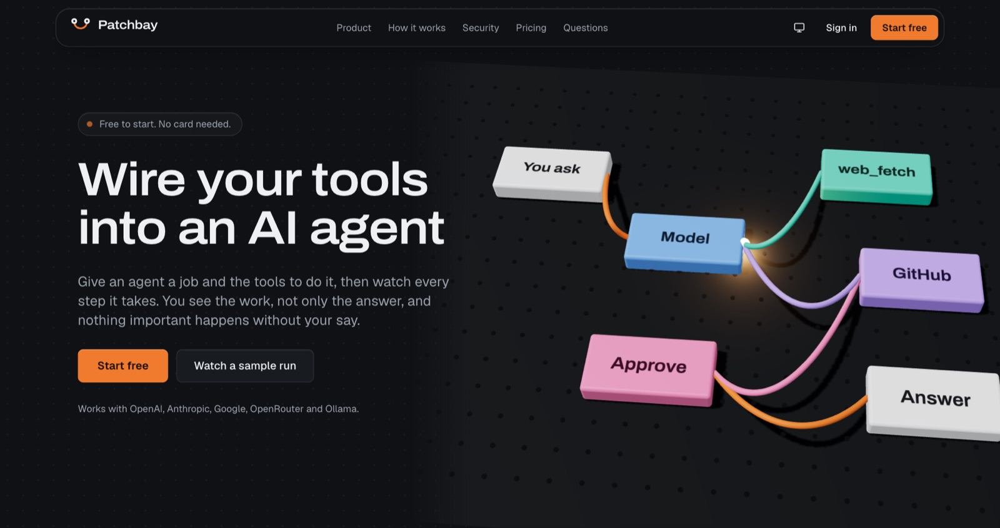
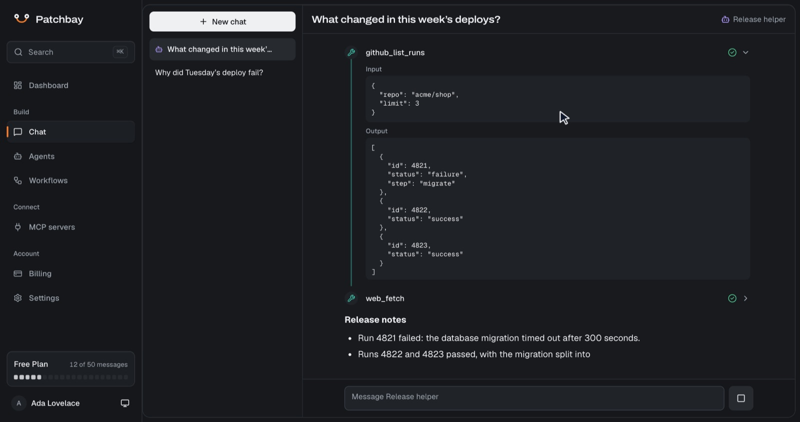
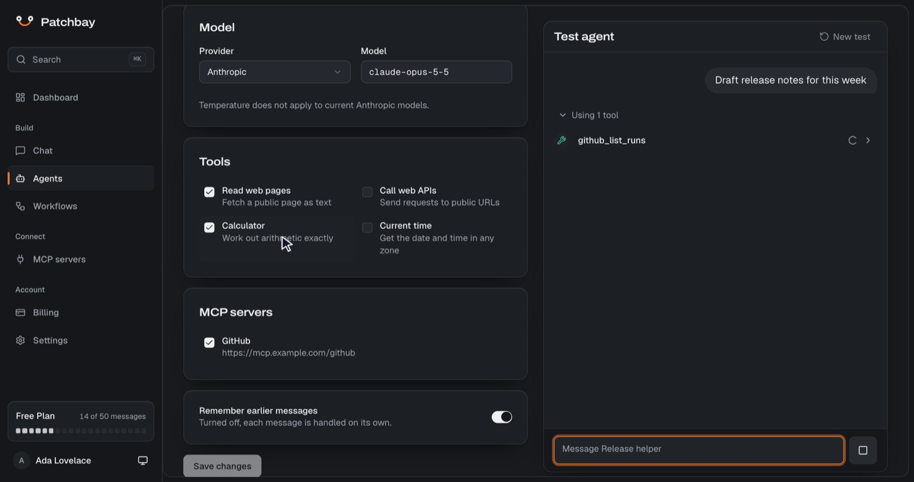
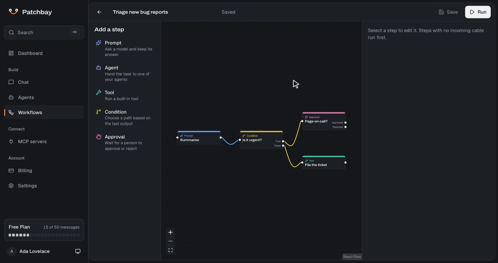
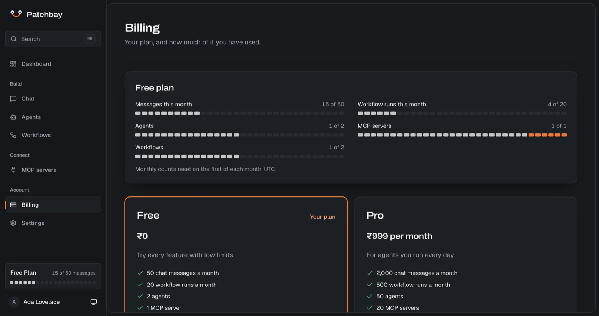

<div align="center">


# Patchbay™

**Build AI agents, wire them to your tools over MCP, and watch every step they take.**

Streaming chat, custom agents, MCP tool servers, visual LangGraph workflows with human approval, and paid plans through Razorpay.


[](LICENSE)


</div>



## Contents

- [Features](#features)
- [Screenshots](#screenshots)
- [Tech stack](#tech-stack)
- [Project structure](#project-structure)
- [Prerequisites](#prerequisites)
- [Run it locally](#run-it-locally)
- [Configuration](#configuration)
- [Environment variables](#environment-variables)
- [Scripts](#scripts)
- [Testing](#testing)
- [Host it for free](#host-it-for-free)
- [Host it on a paid plan](#host-it-on-a-paid-plan)
- [Promo codes](#promo-codes)
- [Plans and limits](#plans-and-limits)
- [Architecture](#architecture)
- [API overview](#api-overview)
- [Scaling](#scaling)
- [Security](#security)
- [Troubleshooting](#troubleshooting)
- [Contributing](#contributing)
- [Author](#author)
- [License](#license)

## Features

- **Streaming chat** with saved history. Switch models mid-conversation, stop a reply, or retry a failed one.
- **Bring any model.** OpenAI, Anthropic, Google, OpenRouter (including its free models) and local models through Ollama. Each user can add their own API keys in Settings.
- **Custom agents** with their own instructions, model, built-in tools and MCP servers, tested on the same screen you build them on.
- **Built-in tools:** `http_request`, `web_fetch`, `calculator` and `current_time`.
- **MCP tool servers** over HTTP or SSE. Credentials are encrypted with AES-256-GCM, and a failing server never takes a run down with it.
- **Visual workflows** on a drag-and-drop board, with prompt, agent, tool, condition and human-approval steps, compiled to LangGraph.
- **Every step visible.** Each tool call shows its input and output.
- **Paid plans** through Razorpay subscriptions (test mode), with limits enforced on the server.
- **Promo codes** for unlimited use, created by the owner from the command line.
- **Command palette** (Ctrl/Cmd + K), light and dark themes, mobile-friendly layout.

## Screenshots

| Chat with visible tool steps                           | Agent builder                                        |
| ------------------------------------------------------ | ---------------------------------------------------- |
|      |  |
| **Workflow board**                                     | **MCP server tools**                                 |
|  |   |
| **Billing and usage**                                  |                                                      |
|                |                                                      |

## Tech stack

| Layer    | Tools                                                                                                               |
| -------- | ------------------------------------------------------------------------------------------------------------------- |
| Client   | React 19, Vite, TypeScript, Tailwind CSS 4, shadcn/ui, Redux Toolkit, RTK Query, React Router, React Flow, three.js |
| Server   | Node.js 22, Express 5, TypeScript, Mongoose, Zod, LangChain, LangGraph, MCP adapters, firebase-admin, pino          |
| Data     | MongoDB (app data and LangGraph checkpoints)                                                                        |
| Sign-in  | Firebase Authentication (Google and email/password)                                                                 |
| Payments | Razorpay subscriptions, test mode only                                                                              |
| Testing  | Vitest, Supertest, mongodb-memory-server, Playwright                                                                |
| Delivery | Docker Compose, nginx, GitHub Actions CI, Render, Cloudflare Pages                                                  |

## Project structure

npm workspaces monorepo with two packages: `server` and `client`.

```
.
├── client/                  React app (Vite)
│   ├── src/
│   │   ├── app/             Redux store, router, typed hooks
│   │   ├── components/      Shared UI (shadcn/ui in components/ui)
│   │   ├── features/        Feature slices: auth, chat, agents, workflows, billing, ...
│   │   ├── lib/             API client, SSE parser, Firebase, Razorpay checkout
│   │   └── pages/           Route components
│   ├── e2e/                 Playwright smoke test with fake auth and a mocked API
│   ├── public/              Static files, incl. _headers and _redirects for CDNs
│   ├── nginx.conf           Serves the build and proxies /api in Docker
│   └── Dockerfile
├── server/                  Express API
│   ├── src/
│   │   ├── config/          Env validation (Zod), MongoDB, Firebase Admin
│   │   ├── controllers/     Route handlers
│   │   ├── middleware/      Auth, plan limits, rate limits, validation, errors
│   │   ├── models/          Mongoose models
│   │   ├── routes/          Route definitions
│   │   ├── services/        LangGraph graphs, LLM providers, MCP manager, tools, billing
│   │   ├── scripts/         promo.ts (promo code CLI)
│   │   └── utils/           Crypto, SSRF guard, SSE, logger
│   ├── test/                Vitest integration tests
│   ├── loadtest/            autocannon load test
│   └── Dockerfile
├── docs/screenshots/
├── docker-compose.yml       mongo + api + web
├── render.yaml              Render Blueprint for the API
├── .env.example             Template for the single root .env
└── .github/workflows/ci.yml Typecheck, lint, tests, e2e, Docker build
```

## Prerequisites

| Tool                                                       | Needed for                                 |
| ---------------------------------------------------------- | ------------------------------------------ |
| [Node.js](https://nodejs.org) 22.12 or newer               | Running without Docker, tests, promo codes |
| [Docker](https://docs.docker.com/get-docker/) with Compose | Running the full stack with one command    |
| MongoDB 8 (local, Docker or Atlas)                         | Running without Docker                     |
| A Firebase project                                         | Signing in                                 |
| At least one model provider (or Ollama)                    | Chatting                                   |
| A Razorpay account in test mode                            | Optional, only for the Pro plan            |

The stack starts without any accounts, but you cannot sign in until Firebase is set up, and you cannot chat until a model is set up. See [Configuration](#configuration).

## Run it locally

### 1. Clone and create `.env`

```bash
git clone https://github.com/hi-vishal/PatchBay.git patchbay
```

```bash
cd patchbay
```

```bash
cp .env.example .env
```

Generate an encryption key and paste it into `.env` as `ENCRYPTION_KEY`. The API will not start without it.

```bash
openssl rand -base64 32
```

No `openssl` (Windows)? Use Node instead:

```bash
node -e "console.log(require('crypto').randomBytes(32).toString('base64'))"
```

Then fill in Firebase and at least one model, as described in [Configuration](#configuration).

### 2a. Option A: Docker Compose (recommended)

Start Docker (Docker Desktop, or `colima start` on macOS), then:

```bash
docker compose up --build
```

Open http://localhost:8080. Compose runs three containers:

| Service | What it is                                      | Address               |
| ------- | ----------------------------------------------- | --------------------- |
| `web`   | nginx serving the built client, proxying `/api` | http://localhost:8080 |
| `api`   | Express API                                     | http://localhost:4000 |
| `mongo` | MongoDB 8 with a named volume `mongo-data`      | `localhost:27017`     |

All ports bind to `127.0.0.1` only. Stop with `Ctrl+C`, or `docker compose down`. Add `-v` to also delete the database volume.

`VITE_*` values are baked into the web image at build time, so run `docker compose up --build` again after changing them.

### 2b. Option B: Node directly (for development)

You need a MongoDB running. The quickest way:

```bash
docker run -d --name patchbay-mongo -p 127.0.0.1:27017:27017 mongo:8
```

Or install MongoDB Community Server, or point `MONGODB_URI` at an Atlas cluster. Then:

```bash
npm install
```

```bash
npm run dev
```

- API: http://localhost:4000 (auto-reloads with `tsx watch`)
- Client: http://localhost:5173 (Vite, with `/api` proxied to the API)

`npm run dev` uses a shell `&`, which works on macOS and Linux. On Windows, run `npm run dev:server` and `npm run dev:client` in two terminals.

### 3. Try the whole product

1. Sign in with Google or email.
2. Open **Chat** and send a message. The reply streams in.
3. Open **MCP servers**, add a server by URL and choose **Test connection** to see its tools. For a server on your own machine, set `MCP_ALLOW_PRIVATE_NETWORKS=true`, and use `host.docker.internal` as the host under Docker.
4. Open **Agents > New agent**, attach that server, save, and send a message in the **Test** panel. Each tool call shows as a step you can open.
5. Open **Workflows**, create one, add steps, connect them, then **Run**. An approval step pauses the run until you approve or reject it.
6. Keep creating until you hit a free-plan limit. You get a notice with a link to billing.
7. Open **Billing > Upgrade to Pro** and pay with a Razorpay test card, or redeem a [promo code](#promo-codes).

## Configuration

Everything goes in the root `.env`, which is git-ignored. Both the server and the client read this one file, and Docker Compose uses it too.

### 1. Firebase (sign-in)

1. Create a project in the [Firebase console](https://console.firebase.google.com).
2. Go to **Build > Authentication > Sign-in method** and enable **Google** and **Email/Password**.
3. Go to **Project settings > General > Your apps**, add a **Web** app and copy its config:

   | `.env`                      | Firebase config |
   | --------------------------- | --------------- |
   | `VITE_FIREBASE_API_KEY`     | `apiKey`        |
   | `VITE_FIREBASE_AUTH_DOMAIN` | `authDomain`    |
   | `VITE_FIREBASE_PROJECT_ID`  | `projectId`     |
   | `VITE_FIREBASE_APP_ID`      | `appId`         |

4. Go to **Project settings > Service accounts > Generate new private key** and copy from the downloaded JSON:

   | `.env`                  | JSON field     |
   | ----------------------- | -------------- |
   | `FIREBASE_PROJECT_ID`   | `project_id`   |
   | `FIREBASE_CLIENT_EMAIL` | `client_email` |
   | `FIREBASE_PRIVATE_KEY`  | `private_key`  |

   Keep the private key in double quotes on one line, with its literal `\n` sequences. Never commit the JSON file.

5. `localhost` is authorized by default. Add every other domain you deploy to under **Authentication > Settings > Authorized domains**.

### 2. AI models (at least one)

Pick any mix of these:

- **Free:** an OpenRouter key runs OpenRouter's free models at no cost.
- **No key at all:** Ollama runs models on your own machine.
- **Per user:** each person adds their own keys under **Settings > AI models**, so the deployment-wide keys can stay empty.

Deployment-wide keys:

| `.env`               | Where to get it                                        |
| -------------------- | ------------------------------------------------------ |
| `ANTHROPIC_API_KEY`  | [console.anthropic.com](https://console.anthropic.com) |
| `OPENAI_API_KEY`     | [platform.openai.com](https://platform.openai.com)     |
| `GOOGLE_API_KEY`     | [aistudio.google.com](https://aistudio.google.com)     |
| `OPENROUTER_API_KEY` | [openrouter.ai/keys](https://openrouter.ai/keys)       |

`DEFAULT_MODEL` is the model plain chat uses, as `provider:model`. Default: `anthropic:claude-opus-5-5`. If you only have another provider's key, change it, for example `openrouter:openrouter/free` or `openai:<model id>`. Model names in the UI are suggestions; any model id your provider offers works.

**OpenRouter.** The free model list is read live from OpenRouter. `openrouter:openrouter/free` lets OpenRouter pick a free model. Because `OPENROUTER_API_KEY` is shared by every user, the server refuses paid models on it; users with their own key can use any model. OpenRouter rate-limits free models separately from this app's plan limits, and some free providers may log prompts.

**Ollama.** Install from [ollama.com](https://ollama.com/download), then run `ollama pull llama3.2`. The app has a full guide at `/app/settings/ollama`.

| How the API runs | `.env`                                                                               |
| ---------------- | ------------------------------------------------------------------------------------ |
| `npm run dev`    | `OLLAMA_BASE_URL=http://localhost:11434`                                             |
| Docker Compose   | `OLLAMA_DOCKER_URL=http://host.docker.internal:11434` (`localhost` is the container) |

The address box in Settings only accepts public addresses (such as a tunnel), because it is user input.

### 3. Razorpay (optional, test mode only)

Without Razorpay, the Pro plan shows as unavailable and everything else works. The API refuses to start with a `RAZORPAY_KEY_ID` that does not begin with `rzp_test_`, so no real money can move.

1. In the [Razorpay dashboard](https://dashboard.razorpay.com), switch to **Test Mode** and stay in it.
2. **Account & Settings > API Keys:** generate a key pair → `RAZORPAY_KEY_ID`, `RAZORPAY_KEY_SECRET`.
3. **Subscriptions > Plans:** create a monthly plan → `RAZORPAY_PRO_PLAN_ID`. Set `PRO_PLAN_PRICE_LABEL` to match its price, for example `₹999 per month`.
4. **Account & Settings > Webhooks:** add a webhook:
   - **URL:** `https://<your-public-host>/api/webhooks/razorpay`
   - **Secret:** any random string, also put in `RAZORPAY_WEBHOOK_SECRET`
   - **Events:** `subscription.authenticated`, `subscription.activated`, `subscription.charged`, `subscription.pending`, `subscription.halted`, `subscription.paused`, `subscription.resumed`, `subscription.updated`, `subscription.cancelled`, `subscription.completed`
   - If the dashboard asks for an OTP in test mode, Razorpay's docs give `754081`.

**Locally,** Razorpay cannot reach `localhost`. Upgrading still works because the app verifies the payment right after Checkout, but renewals, failures and cancellations need the webhook, so use a tunnel such as `ngrok http 8080`.

**To test,** pay with one of Razorpay's [subscription test cards](https://razorpay.com/docs/payments/subscriptions/test/). For renewals and failures, open the subscription in the dashboard and use **Charge this now**, then **Charge as Success** or **Charge as Failure**. One failure moves it to `pending`, four in a row to `halted`; both drop the account to the free plan. Test card tokens last 3 days.

**Going live** is deliberately a code change, not a config change: the `rzp_test_` check lives in `server/src/config/env.ts`.

### 4. MongoDB

Docker Compose runs MongoDB for you. Without Docker, set `MONGODB_URI` to your local server or an Atlas connection string that includes the database name.

## Environment variables

Full template: [`.env.example`](.env.example). The API validates everything at startup and exits with a message naming any bad variable.

| Variable                                                                                    | Required   | Default                     | Purpose                                                                                           |
| ------------------------------------------------------------------------------------------- | ---------- | --------------------------- | ------------------------------------------------------------------------------------------------- |
| `ENCRYPTION_KEY`                                                                            | Yes        | none                        | 32 bytes, base64. Encrypts saved MCP credentials and API keys. Changing it makes them unreadable. |
| `MONGODB_URI`                                                                               | Yes        | none                        | MongoDB connection string. Compose sets its own.                                                  |
| `CORS_ORIGINS`                                                                              | Yes        | `http://localhost:5173`     | Comma-separated browser origins allowed to call the API.                                          |
| `NODE_ENV`                                                                                  | No         | `development`               | `development`, `test` or `production`.                                                            |
| `PORT`                                                                                      | No         | `4000`                      | API port.                                                                                         |
| `LOG_LEVEL`                                                                                 | No         | `info`                      | pino log level.                                                                                   |
| `TRUST_PROXY`                                                                               | No         | `false`                     | `true` behind one reverse proxy, so rate limits see real client IPs.                              |
| `WEB_CONCURRENCY`                                                                           | No         | `1`                         | API processes per machine. Set to CPU cores.                                                      |
| `MONGODB_MAX_POOL_SIZE`                                                                     | No         | `20`                        | DB connections per process.                                                                       |
| `RATE_LIMIT_PER_MINUTE`                                                                     | No         | `300`                       | Requests per IP per minute, per process.                                                          |
| `FIREBASE_PROJECT_ID`, `FIREBASE_CLIENT_EMAIL`, `FIREBASE_PRIVATE_KEY`                      | To sign in | none                        | Firebase Admin service account.                                                                   |
| `ANTHROPIC_API_KEY`, `OPENAI_API_KEY`, `GOOGLE_API_KEY`, `OPENROUTER_API_KEY`               | To chat    | none                        | Deployment-wide model keys.                                                                       |
| `DEFAULT_MODEL`                                                                             | No         | `anthropic:claude-opus-5-5` | `provider:model` for plain chat.                                                                  |
| `OLLAMA_BASE_URL`                                                                           | No         | none                        | Ollama address for `npm run dev`.                                                                 |
| `OLLAMA_DOCKER_URL`                                                                         | No         | none                        | Ollama address under Docker Compose.                                                              |
| `MCP_ALLOW_STDIO`                                                                           | No         | `false`                     | Lets MCP servers run commands on the API host. See [Security](#security).                         |
| `MCP_ALLOW_PRIVATE_NETWORKS`                                                                | No         | `false`                     | Lets MCP servers use private addresses. Local development only.                                   |
| `RAZORPAY_KEY_ID`, `RAZORPAY_KEY_SECRET`, `RAZORPAY_WEBHOOK_SECRET`, `RAZORPAY_PRO_PLAN_ID` | For Pro    | none                        | Razorpay test mode billing.                                                                       |
| `PRO_PLAN_PRICE_LABEL`                                                                      | No         | `₹999 per month`            | Price text shown on the pricing section.                                                          |
| `VITE_API_URL`                                                                              | No         | empty (same origin)         | API address when the client is hosted elsewhere. Build time only.                                 |
| `VITE_FIREBASE_*`                                                                           | To sign in | none                        | Firebase web config. Public. Build time only.                                                     |

`VITE_*` values are public and inlined into the client bundle. Never put secrets in them.

## Scripts

Run from the repository root.

| Command                               | What it does                                         |
| ------------------------------------- | ---------------------------------------------------- |
| `npm run dev`                         | API and client together with hot reload              |
| `npm run dev:server`                  | API only                                             |
| `npm run dev:client`                  | Client only                                          |
| `npm run build`                       | Build both workspaces (`server/dist`, `client/dist`) |
| `npm run typecheck`                   | TypeScript check on both workspaces                  |
| `npm run lint` / `lint:fix`           | ESLint                                               |
| `npm run format` / `format:check`     | Prettier                                             |
| `npm test`                            | Unit and integration tests                           |
| `npm run test:e2e`                    | Playwright smoke test                                |
| `npm run verify`                      | Typecheck, lint, format check and tests (same as CI) |
| `npm run promo -- <cmd>`              | Promo code CLI, see [Promo codes](#promo-codes)      |
| `npm run loadtest --workspace server` | autocannon load test against an in-memory database   |
| `npm start --workspace server`        | Run the built API (`node dist/index.js`)             |

## Testing

```bash
npm run verify
```

Runs typecheck, lint, format check, and all unit and integration tests. Server tests use an in-memory MongoDB, a scripted model and a real MCP server, so they need no accounts or keys.

End-to-end smoke test:

```bash
npm exec --workspace client -- playwright install chromium
```

```bash
npm run test:e2e
```

It runs the real UI against fake sign-in and a mocked API (`client/vite.e2e.config.ts`). That setup lives outside `src`, so no sign-in bypass reaches a production build. Browse it yourself with `npm run dev:e2e --workspace client` on http://localhost:5199.

CI (`.github/workflows/ci.yml`) runs `verify` plus build, the Playwright test and a Docker image build on every push to `main` and every pull request.

## Host it for free

Every part runs on a free tier. Good for demos and portfolios, not paying customers: the free API sleeps when idle, the free database has no backups, and free tiers change, so check current limits before signing up.

| Part     | Free host               | Set up with                                          |
| -------- | ----------------------- | ---------------------------------------------------- |
| Client   | Cloudflare Pages        | Dashboard settings below                             |
| API      | Render free web service | `render.yaml`                                        |
| Database | MongoDB Atlas M0        | Atlas dashboard                                      |
| Sign-in  | Firebase Spark plan     | [Configuration](#1-firebase-sign-in)                 |
| Models   | OpenRouter free models  | `OPENROUTER_API_KEY`                                 |
| Payments | Razorpay test mode      | [Configuration](#3-razorpay-optional-test-mode-only) |

Ollama does not work here, because the API runs on Render, not your computer. Push the repository to GitHub first; both Render and Cloudflare deploy from Git.

### 1. Database on MongoDB Atlas

1. Create a free M0 cluster. Pick a region near your API (for Render Singapore, Mumbai `ap-south-1` is close).
2. **Database Access:** add a user with a generated password.
3. **Network Access:** allow `0.0.0.0/0`, since Render's free plan has no fixed outbound IP.
4. Copy the connection string and add a database name before the `?`, for example `.../patchbay?retryWrites=true`.

### 2. API on Render

1. In Render, choose **New > Blueprint** and pick the repository. Render reads `render.yaml`.
2. Fill in the values it asks for (same as `.env`), noting:
   - `CORS_ORIGINS`: your Pages address, such as `https://patchbay.pages.dev`. Use a placeholder if you don't know it yet, and fix it after step 3.
   - `MONGODB_URI`: the Atlas string.
   - `ENCRYPTION_KEY`: a new one from `openssl rand -base64 32`. Never change it later.
   - Leave unused model and Razorpay keys empty.
3. When the deploy finishes, open `https://<service>.onrender.com/api/health`. It should return `"status":"ok"`.

`render.yaml` already sets `NODE_ENV=production`, `TRUST_PROXY=true`, `WEB_CONCURRENCY=1`, `MONGODB_MAX_POOL_SIZE=10` and `DEFAULT_MODEL=openrouter:openrouter/free`. Values you type are only asked for the first time; change them later in the service's **Environment** tab.

### 3. Client on Cloudflare Pages

Go to **Workers & Pages > Create > Pages > Connect to Git** and enter:

| Setting                | Value                              |
| ---------------------- | ---------------------------------- |
| Framework preset       | None                               |
| Build command          | `npm run build --workspace client` |
| Build output directory | `client/dist`                      |
| Root directory         | Empty (repository root)            |

Build variables (read at build time, so redeploy after changing them):

| Variable                      | Value                                                         |
| ----------------------------- | ------------------------------------------------------------- |
| `VITE_API_URL`                | `https://<service>.onrender.com` (no `/api`, no trailing `/`) |
| `VITE_FIREBASE_API_KEY`       | From your Firebase web config                                 |
| `VITE_FIREBASE_AUTH_DOMAIN`   | From your Firebase web config                                 |
| `VITE_FIREBASE_PROJECT_ID`    | From your Firebase web config                                 |
| `VITE_FIREBASE_APP_ID`        | From your Firebase web config                                 |
| `MONGOMS_DISABLE_POSTINSTALL` | `1` (skips the MongoDB binary only tests need)                |

Pages takes the Node version from `.nvmrc`. `client/public/_headers` and `_redirects` handle caching, security headers and SPA routing. Netlify works the same way with the same settings.

### 4. Connect the pieces

1. On Render, set `CORS_ORIGINS` to the Pages address. Preview deployments get other addresses and need adding too.
2. In Firebase, add the Pages domain under **Authorized domains**.
3. In Razorpay test mode, point the webhook at `https://<service>.onrender.com/api/webhooks/razorpay`.

### 5. Keep the API awake (optional)

A free Render service sleeps after about 15 minutes idle and takes about a minute to wake. A workflow running when it sleeps is marked failed on restart. A free uptime monitor (UptimeRobot, cron-job.org) hitting `/api/health` every 10 minutes keeps it awake, and one always-on service fits in Render's free monthly hours.

### 6. Check it

Sign in on the Pages site, send a chat message and run a workflow with an approval step. If sign-in fails, check authorized domains. If every request fails, check `CORS_ORIGINS` and `VITE_API_URL`.

## Host it on a paid plan

For real users you want an API that never sleeps, a database with backups, and TLS. Two routes. Check each provider's current pricing.

### Option A: one VPS with Docker Compose (cheapest, full control)

Any Linux VPS with 2 GB RAM or more works: Hetzner, DigitalOcean, Linode/Akamai, Vultr, AWS Lightsail, and so on.

1. **Create the server** (Ubuntu LTS), point a domain's `A` record at its IP, and open only SSH, 80 and 443:

   ```bash
   sudo ufw allow OpenSSH && sudo ufw allow 80 && sudo ufw allow 443 && sudo ufw enable
   ```

2. **Install Docker** with the official script:

   ```bash
   curl -fsSL https://get.docker.com | sh
   ```

3. **Clone and configure:**

   ```bash
   git clone https://github.com/hi-vishal/PatchBay.git patchbay && cd patchbay && cp .env.example .env
   ```

   In `.env` set `ENCRYPTION_KEY`, Firebase, model keys, `CORS_ORIGINS=https://your-domain.com`, `NODE_ENV=production`, and `WEB_CONCURRENCY` to the number of CPU cores. Leave `VITE_API_URL` empty, because nginx serves the client and API on one origin.

4. **Start the stack:**

   ```bash
   docker compose up -d --build
   ```

5. **Add TLS.** Compose listens on `127.0.0.1:8080` only, so put a reverse proxy in front. [Caddy](https://caddyserver.com/docs/install) gets certificates automatically. `/etc/caddy/Caddyfile`:

   ```
   your-domain.com {
       reverse_proxy 127.0.0.1:8080
   }
   ```

   ```bash
   sudo systemctl reload caddy
   ```

   Caddy streams SSE without buffering, so chat tokens still arrive live.

6. **Finish:** add the domain to Firebase **Authorized domains**, and point the Razorpay webhook at `https://your-domain.com/api/webhooks/razorpay`.

**Database.** The Compose MongoDB has no password and is reachable only from the server itself. Back up the `mongo-data` volume regularly (for example `docker compose exec mongo mongodump --archive > backup.archive`), or use a managed database such as MongoDB Atlas: change `MONGODB_URI` under the `api` service in `docker-compose.yml` and remove the `mongo` service.

**Updating:**

```bash
git pull && docker compose up -d --build
```

### Option B: managed services (least maintenance)

| Part     | Paid host                                         | Notes                                                                                                                                    |
| -------- | ------------------------------------------------- | ---------------------------------------------------------------------------------------------------------------------------------------- |
| API      | Render paid instance (Starter or above)           | Change `plan: free` to a paid plan in `render.yaml`, or in the dashboard. No sleep, more memory. Raise `WEB_CONCURRENCY` with CPU count. |
| API alt. | Railway, Fly.io, Google Cloud Run, AWS App Runner | Any Docker host works: build `server/Dockerfile` with the repo root as context, expose port 4000, health check `/api/health`.            |
| Database | MongoDB Atlas dedicated tier (M10 or above)       | Backups, more connections. Restrict Network Access to your API's IPs if it has static egress.                                            |
| Client   | Cloudflare Pages, Netlify or Vercel               | Static files; free tiers are usually enough even in production.                                                                          |
| Sign-in  | Firebase Blaze plan                               | Only needed past Spark limits or for phone auth.                                                                                         |
| Models   | Paid provider keys, or users' own keys            | Shared free OpenRouter limits are low for many users.                                                                                    |

On long-running hosts that put a proxy in front (Render, Railway, Fly.io), keep `TRUST_PROXY=true`. On serverless hosts such as Cloud Run, set a minimum of one instance so background workflow runs are not cut off.

## Promo codes

A promo code removes every limit on the account that redeems it. Use one for yourself as the owner, and give others to anyone you want to have unlimited use. Codes work with or without Razorpay.

Codes are created from the command line on a machine that can reach your database, never in the app. From the repository root:

```bash
npm run promo -- create --label "Owner"
```

That prints a code such as `PB-7K2QD-M9XTR-4HWZA`. **Copy it now**: only a hash is stored. Then sign in, open **Billing**, enter it under **Have a promo code?** and choose **Redeem code**.

| Option         | Meaning                                | Default |
| -------------- | -------------------------------------- | ------- |
| `--count N`    | How many codes to make (up to 100)     | 1       |
| `--uses N`     | How many accounts can redeem each code | 1       |
| `--days N`     | Days until an unused code expires      | never   |
| `--label TEXT` | A note for yourself, shown by `list`   | empty   |

```bash
npm run promo -- create --count 5 --days 30 --label "Beta testers"
npm run promo -- list
npm run promo -- revoke <id>
```

`revoke` disables a code and removes unlimited use from everyone who redeemed it; they go back to their own plan.

**On a hosted API:** put that server's `MONGODB_URI` and `ENCRYPTION_KEY` in your local `.env` and run the same command, or run it on the server:

```bash
docker compose exec api node dist/scripts/promo.js create
```

Usage is still counted for unlimited accounts. Redeeming is limited to 10 tries per IP every 15 minutes.

## Plans and limits

Monthly limits, enforced on the server by `server/src/middleware/planGuard.ts`, which returns `402 PLAN_LIMIT_REACHED`.

| Limit         | Free | Pro   | Promo (unlimited) |
| ------------- | ---- | ----- | ----------------- |
| Chat messages | 50   | 2,000 | No limit          |
| Workflow runs | 20   | 500   | No limit          |
| Agents        | 2    | 50    | No limit          |
| MCP servers   | 1    | 20    | No limit          |
| Workflows     | 2    | 50    | No limit          |

Change them in `server/src/services/billing/plans.ts`.

## Architecture

```
Browser ──► web (nginx / CDN) ──/api──► api (Express) ──► MongoDB
                                         │
                                         ├─► LLM providers (OpenAI, Anthropic, Google, OpenRouter, Ollama)
                                         ├─► MCP servers (HTTP / SSE)
                                         ├─► Firebase Admin (verify ID tokens)
                                         └─► Razorpay (subscriptions, webhooks)
```

- **Auth.** The client signs in with Firebase and sends the ID token as a Bearer token. The API verifies it with firebase-admin (`server/src/middleware/protect.ts`).
- **Chat and agents** share one LangGraph loop, `llm → tools → llm`, with a MongoDB checkpointer per thread (`server/src/services/graphs/chatGraph.ts`, `agentGraph.ts`).
- **Workflows** compile a saved board into a LangGraph `StateGraph` (`workflowGraph.ts`). Approval steps use LangGraph interrupts. Runs execute in the background and the client polls them.
- **Streaming** uses Server-Sent Events with `token`, `tool_start`, `tool_end`, `interrupt`, `done` and `error` events.
- **Client state** uses Redux Toolkit and RTK Query; the board uses React Flow.

## API overview

All routes are under `/api`. Everything except health, plans and the webhook needs a Firebase ID token.

| Method and path                                                                                                          | Purpose                                        |
| ------------------------------------------------------------------------------------------------------------------------ | ---------------------------------------------- |
| `GET /health`                                                                                                            | Health check                                   |
| `POST /auth/sync`, `GET /me`                                                                                             | Create or sync the user, get account and usage |
| `POST /chat`                                                                                                             | Streaming chat (SSE)                           |
| `GET /llm/providers`, `GET/PATCH /llm/settings`, `GET /llm/ollama/status`                                                | Models and per-user keys                       |
| `GET/POST /conversations`, `GET/PATCH/DELETE /conversations/:id`, `GET /conversations/:id/messages`                      | Chat history                                   |
| `GET/POST /agents`, `GET/PATCH/DELETE /agents/:id`, `POST /agents/:id/chat`                                              | Agents and agent chat (SSE)                    |
| `GET/POST /mcp-servers`, `GET/PATCH/DELETE /mcp-servers/:id`, `POST /mcp-servers/:id/test`, `GET /mcp-servers/:id/tools` | MCP servers                                    |
| `GET/POST /workflows`, `GET/PATCH/DELETE /workflows/:id`, `POST /workflows/:id/run`                                      | Workflows                                      |
| `GET /runs`, `GET /runs/:id`, `POST /runs/:id/resume`                                                                    | Workflow runs and approvals                    |
| `GET /billing/plans`, `POST /billing/subscribe`, `/verify`, `/cancel`, `/redeem`                                         | Billing and promo codes                        |
| `POST /webhooks/razorpay`                                                                                                | Razorpay webhook (signature checked)           |

## Scaling

- **The client is static.** Serve `client/dist` from any CDN. The landing page has plans built in and works without the API.
- **The API is stateless.** Run more processes with `WEB_CONCURRENCY`, or more machines behind a load balancer.
- **Workflow runs survive restarts elsewhere.** A process only fails runs that stopped reporting for 5 minutes.
- **JSON is gzipped; streams are not,** so tokens arrive one by one.
- **Watch the database pool.** Keep `WEB_CONCURRENCY × MONGODB_MAX_POOL_SIZE × instances` under your database's connection limit (500 on Atlas M0).
- **Rate limits are per process.** With 4 processes, a client can make 4 × `RATE_LIMIT_PER_MINUTE` requests.
- **Load test:** `npm run loadtest --workspace server`. On one process (8-core laptop, in-memory DB), public routes handled about 8,000 req/s and signed-in routes about 2,000 req/s at 200 connections.

## Security

- **Never enable `MCP_ALLOW_STDIO` on a shared deployment.** It lets any signed-in user run commands on the API host.
- **SSRF protection.** `http_request` and `web_fetch` block private addresses before the request, on every redirect, and when the socket connects.
- **Secrets at rest.** API keys and MCP credentials are encrypted with AES-256-GCM. The API only returns whether a key exists and its last 4 characters.
- **Ollama in Settings must be public,** and is re-checked on every connection. Only `.env` can point at a private address.
- **MCP over HTTP has a weaker check.** URLs are validated only before connecting, so a malicious MCP host could still redirect or rebind.
- **Tool output is untrusted.** Web pages and MCP tools can try to mislead a model. Give agents only the tools they need and use approval steps for actions that matter.
- **Hardening built in:** helmet headers, CORS allow-list, rate limits, request validation with Zod, input sanitizing, ownership checks on every resource.
- **Docker Compose MongoDB has no password** and binds to `127.0.0.1`. Use a managed or password-protected database in production.
- **Compose serves plain HTTP.** Put TLS in front of it (see [Host it on a paid plan](#host-it-on-a-paid-plan)).
- **Never commit `.env` or the Firebase service account JSON.** Both are git-ignored.

## Troubleshooting

| Symptom                                            | Fix                                                                                                  |
| -------------------------------------------------- | ---------------------------------------------------------------------------------------------------- |
| API exits with `Invalid environment configuration` | The message names the variable, usually `ENCRYPTION_KEY`.                                            |
| `Cannot connect to the Docker daemon`              | Start Docker Desktop, or `colima start`.                                                             |
| Requests fail with `CORS_NOT_ALLOWED`              | Add the page's origin to `CORS_ORIGINS` and restart the API.                                         |
| Sign-in page says it is not set up                 | `VITE_FIREBASE_*` were empty at build time. Set them and rebuild.                                    |
| `AUTH_NOT_CONFIGURED`                              | The server-side `FIREBASE_*` values are missing.                                                     |
| Sign-in popup fails on a deployed site             | Add the domain to Firebase **Authorized domains**.                                                   |
| "No AI provider is set up"                         | Add a key under Settings > AI models, or in `.env` and restart the API.                              |
| "Ollama is not connected"                          | Follow `/app/settings/ollama`. Check `curl http://localhost:11434/api/tags` first.                   |
| `MODEL_NOT_FREE`                                   | That OpenRouter model is paid. Pick a free one, or add your own key in Settings.                     |
| `URL_NOT_ALLOWED` on an MCP server                 | It resolves to a private address. Use a public URL, or `MCP_ALLOW_PRIVATE_NETWORKS` locally.         |
| API exits naming `RAZORPAY_KEY_ID`                 | Test mode only. Use a key starting with `rzp_test_`.                                                 |
| `PAYMENT_PROVIDER_ERROR`                           | Razorpay refused the request; the API log has the reason. Often a wrong plan id or a live-mode plan. |
| Plan stays Pro after cancelling, locally           | The webhook cannot reach you. Use a tunnel.                                                          |
| First request on Render takes a minute             | The free instance was asleep. See [Keep the API awake](#5-keep-the-api-awake-optional).              |
| Port 8080, 4000 or 27017 already in use            | Stop the other process, or change the host port in `docker-compose.yml`.                             |

## Contributing

1. Create a branch from `main`.
2. Make your change with tests.
3. Run `npm run verify` (and `npm run test:e2e` for UI changes).
4. Open a pull request. CI must pass.

Code style is enforced by ESLint and Prettier (`npm run lint:fix`, `npm run format`).

## Author

**Vishal Gupta**

- Email: [hii.vishalgupta@gmail.com](mailto:hii.vishalgupta@gmail.com)

Questions, ideas and bug reports are welcome. Open an issue or send an email.

## License

Patchbay is released under the [MIT License](LICENSE). You may use, copy, modify, merge, publish, distribute, sublicense and sell copies of the software, provided the copyright notice and license text are kept in all copies or substantial portions.

© 2026 Vishal Gupta.

### Trademark

Patchbay™ is a trademark of Vishal Gupta. The MIT License covers the code only. It does not grant rights to the Patchbay name or logo. If you ship a fork or a derived product, give it a different name and logo.
