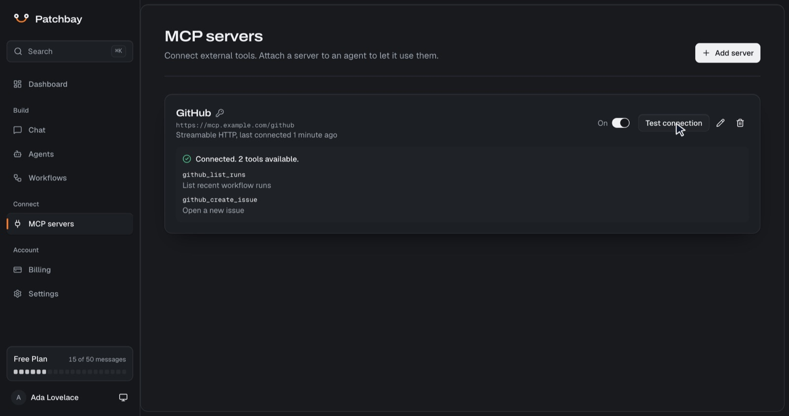

<div align="center">


# Patchbay™

**Build AI agents, wire them to your tools over MCP, and watch every step they take.**

An AI automation platform: streaming chat, custom agents, MCP tool servers, visual LangGraph workflows with human approval, and paid plans through Razorpay.


Created by **Vishal Gupta** · [hii.vishalgupta@gmail.com](mailto:hii.vishalgupta@gmail.com)

</div>


## Contents

- [Features](#features)
- [Screenshots](#screenshots)
- [Tech stack](#tech-stack)
- [Quick start](#quick-start)
- [Setup you need to do](#setup-you-need-to-do)
- [Promo codes (unlimited use)](#promo-codes-unlimited-use)
- [Tests](#tests)
- [Architecture](#architecture)
- [Host it for free](#host-it-for-free)
- [Security](#security)
- [Troubleshooting](#troubleshooting)
- [Author](#author)
- [Trademark and copyright](#trademark-and-copyright)

## Features

- **Streaming chat** with saved history. Switch models mid-conversation, stop a reply partway, or retry one that failed.
- **Any model you like.** OpenAI, Anthropic, Google, OpenRouter (including its free models) and local models through Ollama. Each person can add their own API keys in Settings.
- **Custom agents** with their own instructions, model, built-in tools and MCP servers, tested on the same screen you build them on.
- **MCP tool servers** over HTTP or SSE. Credentials are encrypted with AES-256-GCM, and a failing server never takes a run down with it.
- **Visual workflows** built on a board, with prompt, agent, tool, condition and human approval steps, compiled to LangGraph.
- **Every step visible.** Each tool call shows its input and output, one click away.
- **Paid plans** through Razorpay subscriptions (test mode), with usage limits enforced on the server.
- **Promo codes** that give unlimited use, made by the owner from the command line.
- **Command palette** (Ctrl/Cmd + K), light and dark themes, and a layout that works on phones.

## Screenshots

| Chat with visible tool steps                           | Agent builder                                        |
| ------------------------------------------------------ | ---------------------------------------------------- |
|      |  |
| **Workflow board**                                     | **MCP server tools**                                 |
|  |   |
| **Billing and usage**                                  |                                                      |
|                |                                                      |

## Tech stack

| Layer    | Tools                                                                                                          |
| -------- | -------------------------------------------------------------------------------------------------------------- |
| Client   | React, Vite, TypeScript, Tailwind CSS, shadcn/ui, Redux Toolkit, RTK Query, React Router, React Flow, three.js |
| Server   | Node.js, Express 5, TypeScript, Mongoose, Zod, LangChain, LangGraph, MCP adapters, firebase-admin, pino        |
| Data     | MongoDB, with LangGraph checkpoints stored in MongoDB                                                          |
| Sign-in  | Firebase Authentication (Google and email)                                                                     |
| Payments | Razorpay subscriptions, test mode only                                                                         |
| Testing  | Vitest, Supertest, in-memory MongoDB, Playwright                                                               |
| Delivery | Docker Compose, GitHub Actions CI, Render and Cloudflare Pages                                                 |

## Quick start

Clone the repository first. You need Docker with Compose, and its runtime running (Docker Desktop, or `colima start`). The stack starts without any accounts, but signing in needs Firebase and chatting needs an LLM key. The sections below list every value.

```bash
cp .env.example .env
```

```bash
openssl rand -base64 32
```

Put that output in `.env` as `ENCRYPTION_KEY`. The API will not start without it. Then:

```bash
docker compose up --build
```

Open http://localhost:8080.

## Setup you need to do

Everything here goes in the root `.env`, which is git-ignored. Both the server and the client read that one file.

### 1. Firebase (sign-in)

1. Create a project in the [Firebase console](https://console.firebase.google.com).
2. Go to **Build > Authentication > Sign-in method**. Enable **Google** and **Email/Password**.
3. Go to **Project settings > General > Your apps** and add a **Web** app. Copy these values:

   | `.env`                      | Firebase config |
   | --------------------------- | --------------- |
   | `VITE_FIREBASE_API_KEY`     | `apiKey`        |
   | `VITE_FIREBASE_AUTH_DOMAIN` | `authDomain`    |
   | `VITE_FIREBASE_PROJECT_ID`  | `projectId`     |
   | `VITE_FIREBASE_APP_ID`      | `appId`         |

4. Go to **Project settings > Service accounts > Generate new private key**. Copy these values from the downloaded JSON:

   | `.env`                  | JSON field     |
   | ----------------------- | -------------- |
   | `FIREBASE_PROJECT_ID`   | `project_id`   |
   | `FIREBASE_CLIENT_EMAIL` | `client_email` |
   | `FIREBASE_PRIVATE_KEY`  | `private_key`  |

   Keep the private key in double quotes on one line, with its literal `\n` sequences. Never commit that JSON file.

5. `localhost` is an authorized domain by default. For any other domain, add it under **Authentication > Settings > Authorized domains**.

The `VITE_` values are public and are built into the web image, so rebuild after changing them: `docker compose up --build`.

### 2. AI models (at least one)

You have three ways in, and can mix them. **Free option:** an OpenRouter key runs OpenRouter's free models at no cost. **Without any key:** Ollama runs models on your own machine. **In the app:** each person can add their own keys under **Settings > AI models**, so you can leave all of these empty.

Keys for the whole deployment go in `.env`:

| `.env`               | Where to get it                                        |
| -------------------- | ------------------------------------------------------ |
| `ANTHROPIC_API_KEY`  | [console.anthropic.com](https://console.anthropic.com) |
| `OPENAI_API_KEY`     | [platform.openai.com](https://platform.openai.com)     |
| `GOOGLE_API_KEY`     | [aistudio.google.com](https://aistudio.google.com)     |
| `OPENROUTER_API_KEY` | [openrouter.ai/keys](https://openrouter.ai/keys)       |

`DEFAULT_MODEL` sets the model for plain chat, as `provider:model`. It defaults to `anthropic:claude-opus-5-5`. If you only have another provider's key, change it, for example `openai:<a model id you have access to>`.

The model names the UI suggests are only suggestions. You can type any model id your provider offers.

**OpenRouter.** The app reads the free model list live from OpenRouter, so it stays current, and you can switch between them in the chat box. For an OpenRouter default, use `DEFAULT_MODEL=openrouter:openrouter/free`, which lets OpenRouter pick a free model. `OPENROUTER_API_KEY` is shared by every user, so the server refuses paid models on it. Someone who adds their own key in Settings can use any model. OpenRouter limits how often free models can be called, and these limits are separate from the plan limits here. Some free model providers may keep prompts, so avoid sending anything private to them.

**Ollama.** Install it from [ollama.com](https://ollama.com/download) and run `ollama pull llama3.2`. The app has a full guide at **Settings > AI models > Ollama > Open the Ollama guide** (`/app/settings/ollama`).

| How the API runs | `.env`                                                                                         |
| ---------------- | ---------------------------------------------------------------------------------------------- |
| `npm run dev`    | `OLLAMA_BASE_URL=http://localhost:11434`                                                       |
| Docker Compose   | `OLLAMA_DOCKER_URL=http://host.docker.internal:11434`, because `localhost` means the container |

Everyone on the deployment can use the Ollama set here. The address box in Settings only accepts public addresses, such as a tunnel, because it is user input.

### 3. Razorpay (paid plan, test mode only)

Billing is optional. Without it, the Pro plan shows as not available and everything else works.

This app takes test payments only, so no real money can move. The API refuses to start with a `RAZORPAY_KEY_ID` that does not begin with `rzp_test_`.

1. In the [Razorpay dashboard](https://dashboard.razorpay.com), switch to **Test Mode**. Stay in it for the steps below, because test and live have separate keys, plans and webhooks.
2. Go to **Account & Settings > API Keys** and generate a key pair:

   | `.env`                | Value      |
   | --------------------- | ---------- |
   | `RAZORPAY_KEY_ID`     | Key id     |
   | `RAZORPAY_KEY_SECRET` | Key secret |

3. Go to **Subscriptions > Plans** and create a monthly plan. Put its id in `RAZORPAY_PRO_PLAN_ID`. Set `PRO_PLAN_PRICE_LABEL` to what it costs, for example `₹999 per month`, since that text is what the pricing section shows.
4. Go to **Account & Settings > Webhooks** and add a webhook:
   - **URL:** `https://<your-public-host>/api/webhooks/razorpay`
   - **Secret:** any random string. Put the same string in `RAZORPAY_WEBHOOK_SECRET`.
   - **Events:** `subscription.authenticated`, `subscription.activated`, `subscription.charged`, `subscription.pending`, `subscription.halted`, `subscription.paused`, `subscription.resumed`, `subscription.updated`, `subscription.cancelled`, `subscription.completed`.
   - If the dashboard asks for an OTP in test mode, Razorpay's docs give `754081`.

**On your own machine,** Razorpay cannot reach `localhost`, so use a tunnel such as `ngrok http 8080` for the webhook URL. Upgrading still works without one, because the app confirms the payment with Razorpay right after Checkout. Renewals, failed payments and cancellations do need the webhook.

**To try it,** upgrade in the app with one of Razorpay's [test cards for subscriptions](https://razorpay.com/docs/payments/subscriptions/test/). To test renewals and failures, open the subscription in the dashboard and use **Charge this now**, then **Charge as Success** or **Charge as Failure**. One failure moves it to `pending` and four in a row to `halted`, and both move the account to the free plan. Test card tokens last 3 days, so make these charges soon after paying.

### 4. MongoDB

`docker compose` runs MongoDB for you. To use another database such as Atlas when running without Docker, set `MONGODB_URI`.

## Environment variables

| Variable                               | Required   | Purpose                                                                                                       |
| -------------------------------------- | ---------- | ------------------------------------------------------------------------------------------------------------- |
| `ENCRYPTION_KEY`                       | Yes        | 32 bytes, base64. Encrypts MCP credentials and API keys saved in Settings. Changing it makes them unreadable. |
| `MONGODB_URI`                          | Yes        | Set by compose. Needed for local runs.                                                                        |
| `FIREBASE_*`, `VITE_FIREBASE_*`        | To sign in | See step 1.                                                                                                   |
| `OLLAMA_BASE_URL`, `OLLAMA_DOCKER_URL` | No         | Where the server finds Ollama. See step 2.                                                                    |
| `*_API_KEY`, `DEFAULT_MODEL`           | To chat    | See step 2.                                                                                                   |
| `RAZORPAY_*`, `PRO_PLAN_PRICE_LABEL`   | For Pro    | See step 3.                                                                                                   |
| `CORS_ORIGINS`                         | Yes        | Comma-separated browser origins. Add your domain when you deploy, or requests get a 403.                      |
| `TRUST_PROXY`                          | No         | Set to `true` behind one reverse proxy, so rate limits see real client addresses.                             |
| `MCP_ALLOW_STDIO`                      | No         | Lets MCP servers run commands on the API host. See Security.                                                  |
| `MCP_ALLOW_PRIVATE_NETWORKS`           | No         | Lets MCP servers use private addresses. For local development only.                                           |
| `LOG_LEVEL`, `PORT`                    | No         | Logging and API port.                                                                                         |
| `WEB_CONCURRENCY`                      | No         | API processes to run on one machine. Set it to the number of CPU cores. Default 1.                            |
| `MONGODB_MAX_POOL_SIZE`                | No         | Database connections each process may open. Default 20.                                                       |
| `RATE_LIMIT_PER_MINUTE`                | No         | Requests one address may make each minute. Default 300.                                                       |
| `VITE_API_URL`                         | No         | Address of the API, when the client is hosted somewhere else. Read at build time.                             |

## Try the whole product

1. Sign in with Google or email.
2. Open **Chat** and send a message. The reply streams in.
3. Open **MCP servers**, add a server by URL, and choose **Test connection** to see its tools. To try a server on your own machine, set `MCP_ALLOW_PRIVATE_NETWORKS=true`, and use `host.docker.internal` as the host under Docker.
4. Open **Agents > New agent**, attach that server, save, and send a message in the **Test** panel. Each tool call appears as a step you can open.
5. Open **Workflows**, create one, add steps, drag between their jacks, then **Run**. An approval step pauses the run until you approve or reject it.
6. Keep creating until you pass a limit. The free plan allows 2 agents, 1 MCP server, 2 workflows, 50 messages and 20 runs a month. You get a clear notice with a link to billing.
7. Open **Billing > Upgrade to Pro** and pay with a Razorpay test card.

## Promo codes (unlimited use)

A promo code removes every limit on the account that redeems it. Use one for yourself as the owner, and hand others to anyone you want to give unlimited use. Codes work whether or not Razorpay is set up, and no payment is involved.

Codes are made from the command line on a machine that can reach your database, never in the app. Run these from the repository root, where `.env` is:

```bash
npm run promo -- create --label "Owner"
```

That prints a code such as `PB-7K2QD-M9XTR-4HWZA`. **Copy it now.** Only a hash is stored, so it cannot be shown again. Then sign in, open **Billing**, enter it under **Have a promo code?** and choose **Redeem code**.

| Option         | Meaning                                       | Default |
| -------------- | --------------------------------------------- | ------- |
| `--count N`    | How many codes to make (up to 100)            | 1       |
| `--uses N`     | How many different accounts can redeem a code | 1       |
| `--days N`     | Days until an unused code stops working       | never   |
| `--label TEXT` | A note for yourself, shown by `list`          | empty   |

```bash
npm run promo -- create --count 5 --days 30 --label "Beta testers"
npm run promo -- create --uses 10 --label "Team"
npm run promo -- list
npm run promo -- revoke <id>
```

`list` shows each code's id, last four characters, state and how many times it was used. `revoke` stops a code working and takes unlimited use away from everyone who redeemed it. They go back to their own plan, free or paid Pro.

**Where the API is hosted,** run the same command with that server's `MONGODB_URI` and `ENCRYPTION_KEY` in your local `.env`, or open a shell on the server and run `node dist/scripts/promo.js create` from the `server` folder. With Docker: `docker compose exec api node dist/scripts/promo.js create`.

Unlimited use is still counted, so the dashboard shows real numbers. An unlimited account cannot start a paid checkout, since there is nothing left to buy. Redeeming is limited to 10 tries per address every 15 minutes, and a wrong, expired, revoked or used-up code all get the same reply.

## Develop without Docker

Needs Node 22 and a running MongoDB.

```bash
npm install
```

```bash
npm run dev
```

The API runs on http://localhost:4000 and the client on http://localhost:5173, with `/api` proxied.

## Tests

```bash
npm run verify
```

That runs typecheck, lint, format check, and unit and integration tests. Server tests use an in-memory MongoDB and a real MCP server, so they need no accounts.

```bash
npm exec --workspace client -- playwright install chromium
```

```bash
npm run test:e2e
```

The smoke test runs the real UI against fake sign-in and a scripted API (`client/vite.e2e.config.ts`). That setup lives outside `src`, so no sign-in bypass reaches a production build. You can also browse it yourself with `npm run dev:e2e --workspace client` on http://localhost:5199.

## Architecture

```
client/   React, Vite, Tailwind, shadcn/ui, Redux Toolkit, RTK Query, React Router, React Flow, three.js
server/   Express, Mongoose, Zod, LangChain, LangGraph, MCP adapters, firebase-admin, Razorpay
```

- **Chat and agents** share one LangGraph loop: `llm -> tools -> llm`. A MongoDB checkpointer stores each thread (`server/src/services/graphs/chatGraph.ts`, `agentGraph.ts`).
- **Workflows** compile a saved document into a `StateGraph` (`workflowGraph.ts`). Approval steps use LangGraph interrupts. Runs execute in the background, and the client polls them.
- **Streaming** uses SSE with the events `token`, `tool_start`, `tool_end`, `interrupt`, `done` and `error`.
- **Limits** are enforced by `planGuard` (`server/src/middleware/planGuard.ts`), which returns 402 with the code `PLAN_LIMIT_REACHED`.

## Host it for free

Every part can run on a free plan. This suits a demo or a portfolio, not paying customers: the API sleeps when idle, the free database has no backups, and free tiers change without notice, so check each provider's current limits before you sign up.

| Part     | Free host                 | Set up with                    |
| -------- | ------------------------- | ------------------------------ |
| Client   | Cloudflare Pages          | The dashboard settings below   |
| API      | Render, free web service  | `render.yaml` at the repo root |
| Database | MongoDB Atlas, M0 cluster | The Atlas dashboard            |
| Sign-in  | Firebase, Spark plan      | Setup step 1 above             |
| Models   | OpenRouter's free models  | An `OPENROUTER_API_KEY`        |
| Payments | Razorpay test mode        | Setup step 3 above             |

Ollama does not work here, because the API runs on Render, not on your computer. Both Render and Cloudflare deploy from a Git host, so push the repository to GitHub first.

### 1. Database on MongoDB Atlas

1. Create a free M0 cluster. Mumbai (`ap-south-1`) is closest to Render's Singapore region.
2. Under **Database Access**, add a user with a generated password.
3. Under **Network Access**, allow `0.0.0.0/0`. Render's free plan has no fixed outbound address.
4. Copy the connection string and add a database name before the `?`, such as `.../patchbay?retryWrites=true`.

### 2. API on Render

1. In the Render dashboard, choose **New > Blueprint** and pick the repository. Render reads `render.yaml`.
2. Fill in the values it asks for. They are the same as in `.env`, with these differences:
   - `CORS_ORIGINS` is your Cloudflare Pages address, such as `https://patchbay.pages.dev`. If you do not know it yet, put a placeholder and change it after step 3.
   - `MONGODB_URI` is the Atlas string from step 1.
   - `ENCRYPTION_KEY` must be new: run `openssl rand -base64 32`. Do not change it later, or saved MCP credentials and API keys become unreadable.
   - Leave unused model and Razorpay keys empty.
3. Wait for the deploy, then open `https://<service>.onrender.com/api/health`. It should show `"status":"ok"`.

`render.yaml` already sets `NODE_ENV=production`, `TRUST_PROXY=true`, one process, a pool of 10 connections and `DEFAULT_MODEL=openrouter:openrouter/free`. The values you type are only asked for when the Blueprint is first applied. Change them later under the service's **Environment** tab.

### 3. Client on Cloudflare Pages

Cloudflare Pages has no file for build settings, so enter these under **Workers & Pages > Create > Pages > Connect to Git**:

| Setting                | Value                              |
| ---------------------- | ---------------------------------- |
| Framework preset       | None                               |
| Build command          | `npm run build --workspace client` |
| Build output directory | `client/dist`                      |
| Root directory         | Leave empty (the repo root)        |

Add these build variables. The client reads them when it is built, so rebuild after changing any of them:

| Variable                      | Value                                                                  |
| ----------------------------- | ---------------------------------------------------------------------- |
| `VITE_API_URL`                | `https://<service>.onrender.com`, with no `/api` and no trailing slash |
| `VITE_FIREBASE_API_KEY`       | From your Firebase web app config                                      |
| `VITE_FIREBASE_AUTH_DOMAIN`   | From your Firebase web app config                                      |
| `VITE_FIREBASE_PROJECT_ID`    | From your Firebase web app config                                      |
| `VITE_FIREBASE_APP_ID`        | From your Firebase web app config                                      |
| `MONGOMS_DISABLE_POSTINSTALL` | `1`, which skips downloading the MongoDB binary that only tests need   |

Pages installs dependencies itself, and takes the Node version from `.nvmrc`. The `_headers` and `_redirects` files in `client/public` are already part of the build.

### 4. Connect the pieces

1. On Render, set `CORS_ORIGINS` to the Pages address, if you used a placeholder. Preview deployments get other addresses, so they cannot reach the API unless you add those too.
2. In Firebase, add the Pages domain under **Authentication > Settings > Authorized domains**.
3. In the Razorpay dashboard, in test mode, add a webhook to `https://<service>.onrender.com/api/webhooks/razorpay` with the same secret as `RAZORPAY_WEBHOOK_SECRET`.

### 5. Keep the API awake (optional)

A free Render service sleeps after about 15 minutes without requests, and the next request waits about a minute while it starts. A workflow that is running when it sleeps stops, and is marked failed when the API starts again.

To avoid that, have a free uptime monitor, such as UptimeRobot or cron-job.org, open `https://<service>.onrender.com/api/health` every 10 minutes. One service awake all month fits in Render's free hours.

### 6. Check it

Sign in on the Pages site, send a chat message, and run a workflow that has an approval step. If sign-in fails, check the authorized domain. If every request fails, check `CORS_ORIGINS` and `VITE_API_URL`.

## Running it for many people

What is built in:

- **The client is static files.** Host `client/dist` on a free CDN such as Cloudflare Pages or Netlify. The build includes their `_headers` and `_redirects` files. Build with `VITE_API_URL` set to your API's address, and add the site's origin to `CORS_ORIGINS`.
- **The landing page does not need the API.** It has the plans built in, and the API's plan list can be cached for 5 minutes.
- **The API can run as many processes as you have cores.** Set `WEB_CONCURRENCY`. You can also run it on several machines behind a load balancer, because it keeps no session state.
- **A restart does not fail other machines' workflow runs.** Each process only fails runs that stopped reporting in for 5 minutes.
- **JSON replies are gzipped.** Chat streams are not, so tokens still arrive one by one.

What was measured, with `npm run loadtest --workspace server` on an 8-core Apple M3. This is one API process, an in-memory MongoDB, and the sign-in check stubbed out:

| Route             | 200 connections         | 1,000 connections                     |
| ----------------- | ----------------------- | ------------------------------------- |
| Health            | 8,718 req/s, p99 39 ms  | 8,382 req/s, p99 87 ms, 848 failed    |
| Public plan list  | 8,291 req/s, p99 33 ms  | 8,025 req/s, p99 98 ms, 888 failed    |
| Account and usage | 1,967 req/s, p99 191 ms | 1,692 req/s, p99 5,159 ms, 688 failed |
| List agents       | 2,772 req/s, p99 89 ms  | 2,302 req/s, p99 5,062 ms, 501 failed |

One process is comfortable with a few hundred requests in flight and starts refusing connections at 1,000.

What that means for 50,000 people at once:

- **50,000 people reading the landing page is the CDN's work,** not this code's. We did not test a CDN.
- **50,000 signed-in people is not proven.** If each makes a request every 20 seconds, that is 2,500 requests a second, which is more than one process handled on signed-in routes. It needs several processes and a database that keeps up. Nothing here was tested beyond one process.
- **A free database will give out first.** Free MongoDB tiers cap connections and throttle operations. The numbers above used a database in memory on the same machine.
- **Models are the other limit.** A shared free OpenRouter key has a low limit for the whole deployment. At scale each person needs their own key or their own Ollama.
- **Rate limits are counted per process.** With 4 processes, a client can make 4 times `RATE_LIMIT_PER_MINUTE`.

## Security

- **Do not enable `MCP_ALLOW_STDIO` on a shared deployment.** It lets any signed-in user run commands on the API host.
- **`http_request` and `web_fetch` block private addresses.** Checks run before the request, on every redirect, and again when the socket connects.
- **API keys saved in Settings are encrypted** with AES-256-GCM. The API only ever returns whether a key exists and its last 4 characters.
- **The Ollama address in Settings must be public,** and is checked again on every connection. Only `.env` can point at a private address, because any signed-in user can edit Settings.
- **MCP over HTTP has a weaker check.** The adapter does not allow a custom fetch, so URLs are checked only before connecting. A malicious MCP host could still redirect or rebind.
- **Tool output is untrusted.** Web pages and MCP tools can try to mislead a model. Give agents only the tools they need, and use approval steps for actions that matter.
- **MongoDB has no password in `docker-compose.yml`,** and its port is published on `127.0.0.1` only. Use a managed or password-protected database in production.
- **The compose file serves plain HTTP.** Put TLS in front of it in production.

## Troubleshooting

| Symptom                                             | Fix                                                                                                                            |
| --------------------------------------------------- | ------------------------------------------------------------------------------------------------------------------------------ |
| API exits with `Invalid environment configuration`  | The message names the variable. Usually `ENCRYPTION_KEY`.                                                                      |
| Requests fail with `CORS_NOT_ALLOWED`               | Add the page's origin to `CORS_ORIGINS`.                                                                                       |
| Sign-in page says it is not set up                  | The `VITE_FIREBASE_*` values were empty at build time. Set them and rebuild.                                                   |
| `AUTH_NOT_CONFIGURED`                               | The server-side `FIREBASE_*` values are missing.                                                                               |
| "No AI provider is set up"                          | Add a key under Settings > AI models, or to `.env` and restart the API.                                                        |
| "Ollama is not connected"                           | Follow the guide at `/app/settings/ollama`. Run `curl http://localhost:11434/api/tags` first.                                  |
| `MODEL_NOT_FREE`                                    | That OpenRouter model is paid. Pick a free one, or add your own key in Settings.                                               |
| `URL_NOT_ALLOWED` on an MCP server                  | It resolves to a private address. Use a public URL, or `MCP_ALLOW_PRIVATE_NETWORKS` locally.                                   |
| Plan stays Pro after cancelling, on a local machine | The webhook cannot reach you. Use a tunnel.                                                                                    |
| API exits naming `RAZORPAY_KEY_ID`                  | This app is test mode only. Use a key that begins `rzp_test_`.                                                                 |
| `PAYMENT_PROVIDER_ERROR`                            | Razorpay refused the request, and the API log has its reason. Often a wrong plan id, or a plan from live mode with a test key. |

## Author

**Vishal Gupta**

- Email: [hii.vishalgupta@gmail.com](mailto:hii.vishalgupta@gmail.com)

Questions, ideas and bug reports are welcome. Open an issue or send an email.

## Trademark and copyright

Patchbay™ is a trademark of Vishal Gupta. The name and logo may not be used for other products or services without written permission.

© 2026 Vishal Gupta. All rights reserved.
